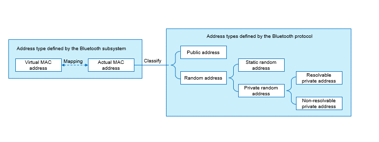

# Bluetooth Service Development Overview

<!--Del-->
> **Note:**
>
> Currently in the beta phase.
<!--DelEnd-->

## Overview

Bluetooth is a short-range wireless technology specified by the Bluetooth Special Interest Group (SIG). It connects devices such as phones, headsets, speakers, keyboards, mice, and printers. The two common categories are Bluetooth BR/EDR (Classic Bluetooth) and Bluetooth Low Energy (BLE).

Bluetooth uses the 2.4 GHz band. Frequency hopping helps reduce interference from other wireless devices. Different protocols control connection procedures and data transmission.

## Classic Bluetooth

Basic Rate/Enhanced Data Rate (BR/EDR), also called Classic Bluetooth, supports profiles for applications such as audio streaming and hands-free communication. These protocol capabilities do not mean every profile is exposed by the Cangjie SDK.

Applications can establish a point-to-point RFCOMM connection using SPP and transfer data. See [SPP Connection and Data Transmission](cj-spp-development-guide.md).

## Bluetooth Low Energy

BLE was introduced in Bluetooth 4.0. It is designed for lower-power communication and is commonly used by wearable devices, smart-home devices, and sensors.

## Bluetooth Device Address Type

During Bluetooth service development, two types of address are defined.

**Figure 1** Bluetooth device address types

- Bluetooth device address type defined by the Bluetooth subsystem. The actual MAC address of a Bluetooth device is considered user private information. During device discovery, the Bluetooth subsystem assigns a virtual MAC address to each Bluetooth device and saves the mapping between the virtual MAC address and the actual MAC address.

- Bluetooth device address type defined by the Bluetooth protocol. The Bluetooth device address types defined by the Bluetooth protocol are classified into two subtypes: public address and random address. Classic Bluetooth devices use public addresses, while Bluetooth Low Energy (BLE) devices can use public addresses or random addresses. Random addresses include static random addresses and private random addresses. Private random addresses are further classified into non-resolvable private addresses and resolvable private addresses. The following table describes each address type.

| Type               | Description    |
| ------------------ |  ------ |
| Public Address       | Public device address, which is allocated by the IEEE and is unique. The address remains unchanged permanently.|
| Static Random Address       | Static random address, which is randomly generated when the Bluetooth device is powered on and initialized. The address does not change in the current power-on period.|
| Resolvable Private Address      | Resolvable private address, which is generated based on an Identity Resolving Key (IRK) and changes periodically (every 15 minutes according to the Bluetooth protocol). If Bluetooth device A has the IRK of Bluetooth device B, device A can identify device B by resolving the resolvable private address of device B.|
| Non-resolvable Private Address       | Unresolvable private address, which is a completely random temporary address that changes periodically (every 15 minutes according to the Bluetooth protocol) and is difficult to trace.|

- In the Bluetooth APIs, a Bluetooth MAC address uses the six-segment colon-separated format: `XX:XX:XX:XX:XX:XX`, where X is a hexadecimal character (0-9, A-F, a-f), for example, `"08:00:27:AB:CD:EF"`.

## Device Roles

During Bluetooth pairing and connection establishment, devices can be classified into two roles based on whether they actively initiate or passively respond to the connection process: Central and Peripheral.

In Bluetooth Classic, a device that discovers nearby devices through inquiry and actively initiates pairing and connections is referred to as a Central device. A device that responds to inquiries and accepts pairing and connection requests from other devices is referred to as a Peripheral device.

In BLE, a device that scans for other devices and actively initiates connections is referred to as a Central device. A device that advertises and accepts connection requests from other devices is referred to as a Peripheral device.

Use [access](../../reference/ConnectivityKit/cj-apis-bluetooth-access.md) for switch control and state subscriptions, and [connection](../../reference/ConnectivityKit/cj-apis-bluetooth-connection.md) for discovery, pairing, and device queries. Address types and device roles are background concepts, not a promise of all address-management APIs in this release.
